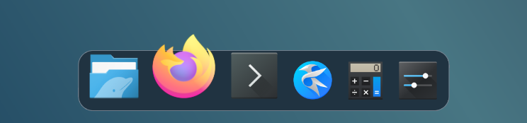
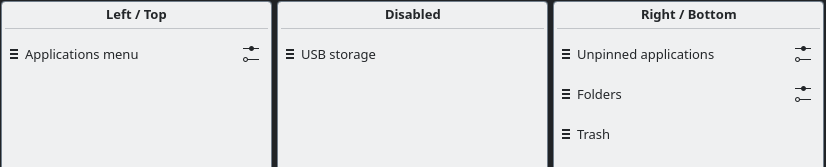

# Plasma Next Dock

I’m not a developer. I had an idea for the dock I wanted on my KDE desktop, and I wanted to make it real. I used Codex to program Plasma Next Dock, tried each change on my own desktop, and kept refining how it felt to use. If you’d like to pick up the project and develop it further, you’re welcome here.

## A dock for KDE Plasma on Wayland

Plasma Next Dock is a standalone, customizable dock for launching applications and switching between their windows. Pin the applications you use every day, then move the pointer across them to magnify the icons. You can keep the dock alongside your existing Plasma panels.



- **Give each screen its own dock.** Keep a compact launcher on your laptop and a full-width bar on an external display. Each dock remembers its edge, launchers, modules and appearance.
- **Choose how windows meet the dock.** Reserve space for it, hide it automatically, or let it move out of the way when a window overlaps it.
- **Work with files and windows.** Drag a document onto an application to open it. Hover over a group of windows while dragging to choose the window where you want to drop it.
- **Shape the dock around your icons.** Choose a solid, gradient or Liquid Glass background, add system blur, adjust each corner, or make the capsule thin enough for the icons to extend beyond it.

## Modules

Pinned applications form the core of each dock. In **Configure Plasma Next Dock → Modules**, drag a module to either side of the launchers or into **Disabled**. The dock includes an applications menu, running unpinned applications, folder shortcuts, Trash and USB storage. For example, put the applications menu on the left and keep folders and Trash within reach on the right.



You can write your own module in QML. Start with the working counter example, change the icon or action, then install it for your user and restart the dock. [Module authoring guide](docs/modules.md) · [Example module](examples/modules/org.example.counter)

## Install from source

Use a **Plasma 6 Wayland session**. The oldest tested configuration is Debian 13 with Plasma 6.3.6 and Qt 6.8.2. See the [compatibility matrix](docs/compatibility.md) for tested distributions and desktop features.

Download and extract **Source code (tar.gz)** from the [1.00.00 release](https://github.com/SarbaLabs/Plasma-Next-Dock/releases/tag/v1.00.00), then run `./install.sh` inside the extracted directory. To get the same stable sources with Git:

```bash
mkdir -p ~/git
cd ~/git
git clone --branch v1.00.00 https://github.com/SarbaLabs/Plasma-Next-Dock.git
cd Plasma-Next-Dock
./install.sh
```

If dependencies are missing, the installer stops and prints the command for your distribution. Run that command, then run `./install.sh` again. The script builds the dock, runs its tests and installs it under `~/.local`.

| Distribution family | How to build |
| --- | --- |
| Debian and Ubuntu, including Kubuntu and KDE neon | Run the installer and use its APT command. It accounts for the different Qt packages on Debian, Kubuntu and neon. |
| Fedora KDE | Run the installer and use its DNF command. |
| openSUSE | Run the installer and use its Zypper command. The reference configuration is Leap 16.1. |
| Arch, including CachyOS | Run the installer and use its paru or pacman command. |
| Bazzite KDE | Build inside a Fedora Distrobox, then launch the dock from Bazzite. [Bazzite instructions](docs/installation.md#bazzite-kde-build-with-distrobox) |

Open **Plasma Next Dock** from the KDE applications menu. Right-click the dock to configure it or pin your first applications. To start it at login, enable the option in **Position and visibility**.

For package lists, updates, rebuilding after Qt upgrades and installation troubleshooting, see the [installation guide](docs/installation.md). For everyday use, see the [dock guide](docs/using-the-dock.md).

## Uninstall

Right-click the dock, choose **Quit Plasma Next Dock**, then run:

```bash
cd ~/git/Plasma-Next-Dock
./uninstall.sh
```

If you downloaded the archive, run the same script from its extracted directory. The uninstaller removes the installed dock and its bundled modules. It keeps your preferences in `~/.config/plasma-next-dock.ini`.

## License and credits

Plasma Next Dock’s own code is licensed under the **GNU General Public License, version 2 or later**. [License](LICENSE)

The project grew out of the [SarbaLabs fork of Plasma macOS Dock](https://github.com/SarbaLabs/plasma-macos-dock), based on [Matt Anis’s original project](https://github.com/Matt-Anis/plasma-macos-dock). The dock also builds on KDE Plasma, KDE Frameworks, Qt and LayerShellQt. The licensing notes identify the adapted KDE task manager and window-preview code, indicator contributions and their original authors and licenses. [Credits and source provenance](docs/licensing.md)
